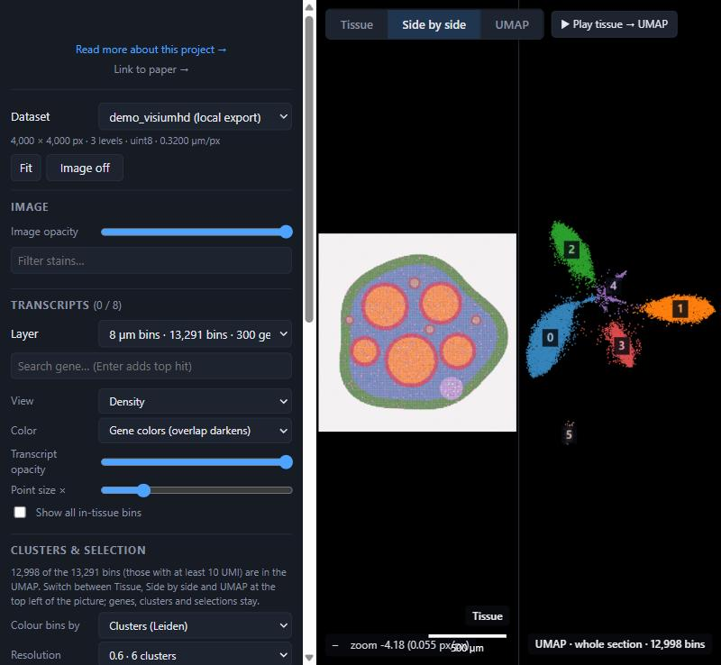

# SODA: Spatial Omics Data Annex

SODA shows very large spatial biology datasets in a web browser:
multiplexed immunofluorescence, H&E, Visium and Visium HD spatial transcriptomics,
Xenium (stains, cells and single transcripts), and single-cell RNA-seq UMAPs. Each slide
is converted once into a pyramid of small image tiles plus compact per-gene files. The browser then
fetches only what is on screen, so a 30-channel whole slide opens in seconds and pans
without downloading the rest. The output is plain static files: you can look at it on
your own computer, put it on any web host for public data, or keep it in a private cloud
container behind a password. No database and no always-on server are needed.

<!-- SCREENSHOT PLACEHOLDER: docs/img/overview.png
     Whole-slide multiplex IF view with the channel panel open. Lead adds the image. -->

## Features

- **Multiplexed fluorescence.** Any number of channels, each with its own colour and
  display window (slider with histogram), blended on the GPU. Channel search, all on/off,
  nuclear stain pinned to the top, empty detector slots hidden.
- **H&E and other brightfield images** shown as a colour photo, alone or under
  expression data.
- **Spatial transcriptomics (Visium, Visium HD).** Search genes and show up to eight at
  once on the tissue, as points or as a density map, at 8 µm, 16 µm or coarser bins.
- **Xenium.** The morphology stains, the segmented cells as an expression layer (gene maps,
  UMAP and Leiden clusters, suggested names, QC, Circle → UMAP and the volcano panel work on
  cells exactly as on bins), and the individual transcripts: pick genes in the Molecules
  panel and each one's molecules are drawn as coloured dots on the stains, several genes at
  once, fetched one gene at a time.
- **GeoMx DSP.** A study of hand-drawn regions (ROIs) rather than cells or bins: the scans
  (several slides side by side), the ROI outlines, and one disc per ROI segment coloured by a
  gene. The columns of the annotation sheet are the groups: legend, heatmap / dot plot /
  violin and the volcano compare groups of ROIs, and the QC panel has the GeoMx values (reads,
  saturation, nuclei, area, negative-probe background, LOQ). What works for ROI data is the
  comparing of groups; a UMAP, clusters, cell-type suggestions and density maps are not made
  for a few dozen regions, and the viewer says so instead of showing them. Counts are shown as
  counts per 10,000 in the plots (Q3 normalisation is not built in).
- **CosMx SMI and MERSCOPE.** The same three parts as Xenium, from the vendors' flat files:
  the per-FOV CosMx images stitched into one mosaic (raw stains or the rendered composite),
  or one z-plane of the MERSCOPE mosaic stains; the cells as an expression layer; and
  every transcript in the Molecules panel. Control probes and blanks are left out, and a
  dataset that comes without images still opens on a transcript-density background.
- **Tissue | Side by side | UMAP.** Each section's bins are embedded once into a UMAP
  with Leiden clusters (three resolutions, marker genes per cluster). Switch the main view
  between the tissue and the UMAP, or show both linked side by side: select bins in one
  (box or freehand) and the same bins light up in the other. **Show on slide** takes any
  selection, picked cluster or cell type back to the tissue and frames it there.
- **Suggested cluster names.** Each cluster gets a suggested cell type from editable
  marker lists, with a confidence and the runner-up shown; accept it, accept all
  high-confidence ones, or type your own. General lists for any tissue (genes and protein
  panels, with common marker-name aliases) are used by default; peripheral nerve lists are
  included too.
- **Circle → UMAP.** Draw circles or freehand shapes on the tissue and get a UMAP, with
  optional Leiden clusters, of just the bins inside, computed in the browser. Drag a box or
  a loop over dots in its UMAP (Shift or **+** adds more) to light those bins on the slide,
  and **Show on slide** to frame them. Save the shapes and every parameter to redo it later.
- **Bin QC filter.** Histograms of total counts, genes detected and % mitochondrial per bin,
  each with min / max thresholds. Off until you move a slider; removed bins are greyed on the
  slide and left out of Circle → UMAP, and the thresholds are saved with the shapes and in
  the page link.
- **Heatmap, dot plot and violin plots.** Compare genes across groups: the section's clusters
  at any resolution, the shapes you drew, Circle → UMAP clusters, the regions of an overlay,
  or (single-cell datasets) any annotation column. Genes are each group's top markers plus any
  you type. A bin's value is log1p(counts per 10k); the heatmap shows the group mean (as it
  is, or z-scored / scaled 0–1 per gene), the dot plot adds the share of bins expressing, and
  violins show the spread with median and quartiles, with an "expressing only" switch because
  most bins hold zero. Every group shows its number of bins and the QC filter applies. Click a
  gene or a group to **show it on the slide**; save PNG, SVG, or the plotted numbers as CSV.
  Computed in your browser from the per-gene files (a typical cluster heatmap of a Visium HD
  section reads roughly 10–30 MB).
- **Multiplexed protein images (Akoya / PhenoCycler and other multi-channel TIFFs).** The
  slide is cut into 16 µm squares holding each marker's mean intensity (from full-resolution
  pixels), and the squares get everything above: UMAP, Leiden clusters, suggested names from
  protein marker lists, and Circle → UMAP. Each marker is normalised per slide (background
  off, scaled to its 99.5th percentile, asinh), empty and duplicate channels are dropped
  automatically, and a slide QC box lists weak and saturated stains and outlines folds and
  bright edges. Set a cut-off per marker (by eye or Otsu) to read the % of tissue squares
  positive for it, or count squares per cluster. No cell segmentation (yet).
- **Region overlays.** GeoJSON regions (for example from QuPath) drawn over the image;
  click a region to restrict the gene density to its bins.
- **Single-cell RNA-seq.** UMAP from AnnData (`.h5ad`) or 10x output, coloured by cluster
  with automatically placed labels, plus up to twelve gene expression panels.
- **Host it yourself.** Static files work on any web host. Optional password protection
  for private data on Azure, or a small live tile server for a lab network.
- **De-identification tools.** Sample IDs are replaced by numbers through a private key,
  and a check command gates uploads.



*The synthetic demo dataset (below) in "Side by side" mode, coloured by Leiden cluster.*

<!-- SCREENSHOT PLACEHOLDER: docs/img/circle_umap.png
     Circle -> UMAP: two circles on the tissue and the resulting UMAP panel. -->

## Try it in 5 minutes

This makes a small synthetic dataset (no real tissue or patient data), prepares it and
opens it. You need Python 3.10 or newer, Git, and an internet connection.

**1. Get the code and make a virtual environment.**

macOS / Linux:

```bash
git clone <this repository's URL> spatial-viewer
cd spatial-viewer
python3 -m venv .venv
source .venv/bin/activate
```

Windows (PowerShell):

```powershell
git clone <this repository's URL> spatial-viewer
cd spatial-viewer
py -m venv .venv
.venv\Scripts\Activate.ps1
```

(If PowerShell refuses to run the activation script, use Command Prompt instead and run
`.venv\Scripts\activate.bat`.) Once the environment is active, `python` means the
environment's Python on every system.

**2. Install, make the demo data, prepare and export it.** Same commands on every system:

```bash
pip install -r web/SpatialViewer/requirements.txt -r web/SpatialViewer/requirements-clustering.txt
python examples/make_demo.py --out demo/raw
python web/SpatialViewer/prepare.py visium --id demo_visiumhd --image demo/raw/visiumhd/image.tif --outs demo/raw/visiumhd/outs --out demo/cache
python web/SpatialViewer/prepare.py tiff   --id demo_multiplex --src demo/raw/multiplex.ome.tif --out demo/cache
python web/SpatialViewer/prepare.py export --id demo_visiumhd  --out demo/cache --dest demo/export --markers examples/demo_markers.json
python web/SpatialViewer/prepare.py export --id demo_multiplex --out demo/cache --dest demo/export --fmt jpg --markers examples/demo_protein_markers.json
```

`make_demo.py` writes a Space Ranger-shaped Visium HD folder (`demo/raw/visiumhd/`: an
H&E-like image and `outs/` with 8 µm and 16 µm bins) and a small 6-channel fluorescence
image (`demo/raw/multiplex.ome.tif`). Everything goes under `demo/`, which Git ignores.

**3. Start two local web servers**, each in its own terminal window (activate the
environment in each). One serves the data, one serves the page:

```bash
python web/SpatialViewer/static_serve.py demo/export 8765
```

```bash
python -m http.server 8766 --directory web/SpatialViewer
```

**4. Open** this address in Chrome:

```
http://localhost:8766/index.html?static=http://localhost:8765&ds=demo_visiumhd
```

Search a gene (for example `MARKER_FASC1`), then try the **Tissue | Side by side | UMAP**
switch. Change `ds=demo_visiumhd` to `ds=demo_multiplex` for the fluorescence image.
Press Ctrl+C in both terminals to stop.

To check that everything above works without opening a browser:

```bash
python tests/smoke_test.py
```

It runs the same steps and then checks every output file.

## Use your own data

1. **[Prepare your data](docs/PREPARING_DATA.md):** one command per input type
   (Visium HD, Visium, Xenium, CosMx, MERSCOPE, GeoMx DSP, OME-TIFF / QPTIFF, per-marker TIFF folders, H&E,
   `.h5ad` or 10x RNA-seq), then `prepare.py export`.
2. **[De-identify and check](docs/DEIDENTIFICATION.md)** before anything leaves your
   computer.
3. **[Host it](docs/HOSTING.md):** on your own computer, on any static web host for public
   data, or privately on Azure with a password
   ([step by step](deploy/azure/README.md)).

The page reads `web/SpatialViewer/config.js` for your dataset list, institution name,
logos and password endpoint. Copy `config.example.js` to `config.js`; every option is
explained in that file. `config.js` is listed in `.gitignore`.

**Rather not set it up yourself?** We can prepare and host your datasets for you. Please
email wbuchser@wustl.edu with any questions about hosting.

## Documentation

| | |
|---|---|
| [docs/PREPARING_DATA.md](docs/PREPARING_DATA.md) | commands and options per input type, export, clustering, the circle tool, common problems |
| [docs/HOSTING.md](docs/HOSTING.md) | hosting options from a laptop to a password-protected cloud site; pre-upload checklist |
| [deploy/azure/README.md](deploy/azure/README.md) | Azure Static Web App + private blob container + password, step by step |
| [docs/DEIDENTIFICATION.md](docs/DEIDENTIFICATION.md) | `deid.py`, the private key file, the upload gate, and its limits |
| [docs/DATA_FORMAT.md](docs/DATA_FORMAT.md) | the exported file tree, byte by byte, for people writing their own tools |

## Requirements

- **Python 3.10 or newer** for preparing data (the pinned NumPy 2 and SciPy 1.14 need it).
  The automated test runs on Python 3.12 on Ubuntu. The tools are developed on Windows;
  macOS has not been tested by us.
- Packages: `web/SpatialViewer/requirements.txt` (reading images and counts, export, tile
  server). `web/SpatialViewer/requirements-clustering.txt` is optional and adds the
  whole-section UMAP and Leiden clusters (scikit-learn, umap-learn, igraph, leidenalg).
- Disk space: the prepare cache holds a compressed full-resolution copy of each image, and
  the export a tiled copy. Memory and time have not been benchmarked; large Visium HD
  datasets need the most (see [How big and how long](docs/PREPARING_DATA.md#how-big-and-how-long)).
- Viewing needs no installation, only a browser and an internet connection (the page loads
  its drawing library from a public CDN).

## Browser support

The viewer needs **WebGL2**. It is developed and tested in **Google Chrome** on desktop.
Other desktop browsers (Edge, Firefox, Safari) have not been tested; they may work if they
support WebGL2. Password-encrypted dataset links need the page to be served over
`https://` or from `localhost`.

**Phones and tablets** open the same page and link; the layout follows the screen.

- On a phone held upright the map fills the screen and the controls sit in a sheet under
  it: tap or drag its handle. Side by side puts the tissue above the UMAP. Tablets and
  phones on their side keep the sidebar.
- Touch: pinch to zoom, drag to pan, tap a spot to read it (what hovering shows on a
  computer). While drawing a shape, one finger draws and two fingers move the picture.
  "Add to the selection" and "Done drawing" stand in for Shift and Esc.
- A phone has far less memory and a slower single core than a desktop, so on a touch
  screen the viewer draws at most 2× the screen's CSS pixels, keeps fewer image tiles,
  notes when more than 10 stains are on (a phone can run out of memory and reload the
  page), and Circle → UMAP samples at most 20,000 bins (50,000 on a computer) and keeps
  the screen on while it runs. Heatmaps and violins take up to 40 genes at a time (150 on a
  computer) and ask before downloading more than 30 MB of gene files. A shape file saved on a phone records that limit; rerun on
  a computer, a selection of more than 20,000 bins is sampled up to 50,000 instead.

The phone layout and touch handling were tested in Chrome's phone emulation and on an
iPhone, opening a password-protected Azure deployment.

**If the image does not appear** (most often on a phone), the page now says why in the
status line: tiles the data store refused, tiles that did not download or decode, no
WebGL2 (iOS before 15, or Lockdown Mode), or graphics memory the browser took back. Tiles
that failed are asked for again by themselves, and again when the page comes back to the
front. For the rest, add `&diag=1` to the address after signing in as usual
(`.../index.html?ds=<id>&diag=1`): a panel lists the browser and iOS version, WebGL2 and
its limits, one manifest and one tile fetched the way the viewer fetches them, each way of
decoding that tile, whether it reaches a texture and draws, what the map holds, and the
first errors caught. **Copy** puts the report on the clipboard. It never shows the
password or the access token: everything after `?` in an address is dropped. `&decode=img`
(or `&decode=plain`) makes the viewer decode tiles through an `` element (or without
createImageBitmap's options), to compare on a device where the default fails.
`tests/phone_browser_test.js` runs these cases in Playwright's WebKit and Chromium; that
WebKit is the engine, not iOS Safari, so a real iPhone is still the only proof for one.

## Repository layout

```
web/SpatialViewer/    the page (index.html, viewer.js, ...) and the Python tools (prepare.py, export.py, ...)
web/SpatialViewer/markers/  marker-gene lists for suggested cluster names (edit for your tissue)
deploy/azure/         Azure Static Web Apps config and the /api/token function
docs/                 documentation
examples/make_demo.py synthetic demo data
examples/make_xenium_demo.py  synthetic Xenium output folder (cells, transcripts, stains)
examples/make_geomx_demo.py   synthetic GeoMx DSP study (DCC, PKC, annotation sheets, scans with ROIs)
examples/make_imaging_demo.py  synthetic CosMx and MERSCOPE folders (FOV images / mosaics, cells, transcripts)
tests/smoke_test.py   end-to-end test
tests/phone_browser_test.js  the image path in phone browsers, with each failure injected (needs Playwright)
tests/diag_test.js    the ?diag=1 panel never prints tokens (node only; the smoke test runs it)
tools/label_editor.html  place UMAP cluster labels by hand (writes labelPositions for config.js)
```

## Citing

Manuscript in preparation. Until it is published, please cite this repository by its URL.
<!-- CITATION PLACEHOLDER: replace with the paper reference and DOI once available. -->

## License

©2026 Washington University. Non-commercial, non-clinical research use; see
[LICENSE](LICENSE). For a commercial license, contact Washington University's Office
of Technology Management at otm@wustl.edu.
