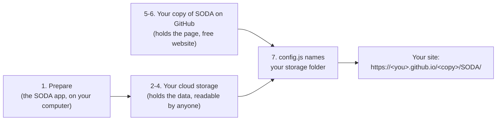

# Share your data: your own SODA website

At the end of this guide you have **your own SODA website**, at an address such as
`https://smithlab.github.io/smithlab-soda/SODA/`, that opens your data for anyone with the link.
Readers install nothing.

Your data and the website live in two different places, both yours:



**Time:** about an hour the first time, after the data is prepared. **Cost:** GitHub is free;
cloud storage charges a little for what is stored and for what readers download.

## Before you start: who may see the data?

Anyone with your site's address can view **and download** the data. Follow this guide only for
data that may be public: published or example data, with nothing that identifies a patient or
donor.

- **Must stay private, for your lab:** a password-protected SODA site on Azure. This needs
  your IT or cloud administrator: [deploy/azure/README.md](../deploy/azure/README.md).
- **Only you:** upload nothing. The SODA app's **Open viewer** shows your data on your own
  computer.
- More ways (a link with a read pass, your own web server):
  [ADVANCED.md, section 1](ADVANCED.md#1-other-places-for-your-data-and-the-page).

## Words you will meet

| Word | Meaning |
|---|---|
| **Cloud storage** | space you rent from Microsoft (Azure Blob Storage), Amazon (AWS S3) or Google (Google Cloud Storage) where every file gets its own web address. Box, Google Drive, Dropbox and OneDrive do **not** work: their links open a preview page, not the file. |
| **Container / bucket** | a top-level folder in cloud storage (Azure says container; AWS and Google say bucket). |
| **Public read** | anyone who knows a file's address may download it. Your site needs this. |
| **CORS** | a setting on your storage that lets your website read the files. Set once (Step 4). |
| **GitHub** | a free website that keeps code. Your copy of SODA lives there, and GitHub publishes it as a website (GitHub Pages). |
| **Repository** | one project's folder of files on GitHub. "Your copy of SODA" is a repository. |
| **Commit** | GitHub's word for "save a change". |

---

## Step 1. Prepare your data with the SODA app

Download the app from **https://github.com/FIVE-MGI/SODA/releases/latest**, pick your data
folder, and click **Prepare**. Every click: [GETTING_STARTED.md, Part A](GETTING_STARTED.md#part-a-the-soda-app-no-code).

✅ The app shows a **green** banner ("clean: the export folder can be shared"). The folder to
upload is the `export` folder inside the output folder you picked. It holds one folder per
dataset and a file called `datasets.json`.

(Used the notebook instead? Your folder is `SODA_work/export` after its Section 5. Made the
export on the command line? First run `python web/SpatialViewer/catalog.py <export folder>`
and `python web/SpatialViewer/deid.py check <export folder>`, see
[DEIDENTIFICATION.md](DEIDENTIFICATION.md).)

## Step 2. Make your cloud storage (once)

You need an account with one of the three. Many universities provide Azure; ask your IT.
This guide clicks through **Azure**; AWS and Google are below.

> **Universities often switch off public storage.** If an option below is greyed out or
> refused ("disallowed by policy"), ask your IT to allow public read for one storage
> account, or keep the data private with the password option
> ([deploy/azure/README.md](../deploy/azure/README.md), needs your IT or cloud administrator).

**Azure:**

1. Go to https://portal.azure.com and sign in.
2. In the search bar at the top, type **Storage accounts**, open it, click **+ Create**:
   - Resource group: **Create new** → `soda`
   - Storage account name: lowercase letters and digits, unique worldwide, e.g. `smithlabsoda`
   - Region: near you. Performance: **Standard**. Redundancy: **LRS**.
   - **Advanced** tab: tick **Allow enabling anonymous access on individual containers**.
   - **Review + create** → **Create**. ✅ "Your deployment is complete" → **Go to resource**.
3. Left menu **Data storage → Containers** → **+ Container**: name `soda`, Anonymous access
   level **Blob (anonymous read access for blobs only)** → **Create**. ✅ `soda` is in the list
   with access level Blob.

**AWS S3:** create a bucket, untick **Block all public access**, and add a bucket policy that
allows `s3:GetObject` for everyone (`"Principal": "*"`).
**Google Cloud Storage:** create a bucket with uniform access, then **Permissions → Grant
access**: `allUsers`, role **Storage Object Viewer**.

## Step 3. Upload the export folder

Upload the whole `export` folder as it is, keeping every file name and sub-folder. It holds
thousands of small files, so use an upload tool, **not** drag-and-drop on the storage's web
page (it stops part-way or takes hours).

- **Azure, by clicking (easiest):** install **Azure Storage Explorer**
  (https://azure.microsoft.com/products/storage/storage-explorer/), open it, **Sign in with
  Azure** (the person icon on the left). In the left tree: your subscription → **Storage
  Accounts** → your account → **Blob Containers** → `soda`. Click **Upload → Upload
  Folder…**, choose the `export` folder → **Upload**. ✅ The bar at the bottom says the
  transfer completed, with no failures.
- **Azure, command line:** `azcopy login`, then
  `azcopy copy "<path to>/export" "https://<account>.blob.core.windows.net/soda/" --recursive`
  (your account needs the *Storage Blob Data Contributor* role; ask IT).
- **AWS:** `aws s3 sync "<path to>/export" s3://<bucket>/export/`
- **Google:** `gcloud storage cp -r "<path to>/export" gs://<bucket>/`

Upload **only** `export`. Never the `cache` or `inputs` folders, or any key file.

Your **storage folder address** is the web address of that uploaded folder, ending in `/`:

| Storage | Address |
|---|---|
| Azure | `https://<account>.blob.core.windows.net/soda/export/` |
| AWS S3 | `https://<bucket>.s3.<region>.amazonaws.com/export/` |
| Google | `https://storage.googleapis.com/<bucket>/export/` |

✅ Check it: open that address followed by `datasets.json` in your browser (e.g.
`https://smithlabsoda.blob.core.windows.net/soda/export/datasets.json`). You see a page of
text starting with `{`. An error page means the folder is not public (Step 2) or the address
is wrong.

## Step 4. Let your site read your storage (CORS, once)

Browsers only let a website read files from another website if that one allows it. This
setting is called CORS. You allow **your site's address**: `https://<your GitHub name>.github.io`,
in small letters, with nothing after `.io` (not `/SODA/`, no `/` at the end). If you do not
have a GitHub account yet, make one first (Step 5) to know your name.

- **Azure:** storage account → left menu **Settings → Resource sharing (CORS)** → **Blob
  service** tab → fill one row → **Save**:

  | Allowed origins | Allowed methods | Allowed headers | Exposed headers | Max age |
  |---|---|---|---|---|
  | `https://<your GitHub name>.github.io` | `GET`, `HEAD`, `OPTIONS` | `*` | `*` | `3600` |

- **AWS S3:** bucket → **Permissions → Cross-origin resource sharing (CORS) → Edit**, paste:
  ```json
  [{ "AllowedOrigins": ["https://<your GitHub name>.github.io"], "AllowedMethods": ["GET", "HEAD"],
     "AllowedHeaders": ["*"], "ExposeHeaders": ["Content-Range", "Content-Length"], "MaxAgeSeconds": 3600 }]
  ```
- **Google:** save
  `[{"origin": ["https://<your GitHub name>.github.io"], "method": ["GET", "HEAD"], "responseHeader": ["Content-Type", "Range", "Content-Range", "Content-Length"], "maxAgeSeconds": 3600}]`
  as `cors.json` and run `gcloud storage buckets update gs://<bucket> --cors-file=cors.json`.

Why `Range`: the page reads one gene at a time out of a few large files, asking for "bytes
4,128 to 6,563 of this file" (an HTTP Range request). The rules above allow that. Several
addresses can share one rule: add one per line (Azure) or inside the `[...]` list.

## Step 5. Make your own copy of SODA

1. Make a free GitHub account at https://github.com/signup if you have none. Your **GitHub
   name** (or your lab's organisation name) is part of your site's address.
2. Open **https://github.com/FIVE-MGI/SODA** and click the green **Use this template** button
   → **Create a new repository**.
3. Owner: you (or your lab's organisation). Repository name: something with `soda` in it,
   e.g. `smithlab-soda`. Choose **Public** (free GitHub websites need it). Click **Create
   repository**.

✅ You are on your copy's page, `https://github.com/<your GitHub name>/<repository name>`,
with the same files as SODA.

## Step 6. Turn on its website

1. In your copy, click **Settings** (top) → **Pages** (left) → under **Build and deployment**,
   **Source: GitHub Actions**.
2. Click **Actions** (top) → **pages** (left) → **Run workflow** → **Run workflow**.

Creating the copy has probably started this workflow once already. That first run ends
**green**, with a notice "Turn on GitHub Pages": nothing is wrong, it is telling you to do
point 1, then run it again (point 2).

✅ After a minute or two the run has a green tick, and its summary says "SODA is published" with
your site's address:

```
https://<your GitHub name>.github.io/<repository name>/SODA/
```

(`https://<your GitHub name>.github.io/<repository name>/` forwards there.) Open it: it shows
**"No data connected yet"**. That is right: Step 7 connects your data.

No **Pages** in Settings, or no **GitHub Actions** choice? The copy must be Public:
**Settings → General → Danger Zone → Change visibility**.

## Step 7. Connect your data

1. In your copy on GitHub, open the folders **web** → **SpatialViewer** and click
   **config.js**.
2. Click the **pencil** icon (top right of the file, "Edit this file").
3. Find the line `data: "",` and paste your storage folder address (Step 3) between the two
   quotes:
   ```js
   data: "https://smithlabsoda.blob.core.windows.net/soda/export/",
   ```
   Optional, in the same file: the title at the top of the page (`title: "SODA",`) and a line
   of small print (`byline: "",`).
4. Click **Commit changes…**, then **Commit changes** in the box that opens.

✅ About two minutes later (the **Actions** tab shows the run), reload your site. Your datasets
are in the **Dataset** menu and genes load. Check it once in a private browser window too.

That address is what you put in your paper, your lab page or an email. Every later change
you commit republishes the site by itself.

## Step 8 (optional). Your own address

To use an address such as `https://gliaportal.mgifive.org/SODA/` instead of the github.io one:

1. Ask whoever runs your domain (often IT) for a **CNAME record**: name `gliaportal` (the
   part before your domain), pointing to `<your GitHub name>.github.io`.
2. In your copy: **Settings → Pages → Custom domain**, type `gliaportal.mgifive.org` →
   **Save**. When GitHub has checked it (minutes to a day), tick **Enforce HTTPS**.
3. Add `https://gliaportal.mgifive.org` to your storage's CORS rule (Step 4).

✅ Your site is now at `https://gliaportal.mgifive.org/SODA/` (the old github.io address
forwards there).

---

## Changing things later

| To change | Where |
|---|---|
| dataset names, groups, order, which stains show, the collection's title | `datasets.json` in your storage folder (below) |
| the site's title, logos, small print, paper link | `web/SpatialViewer/config.js` in your copy (pencil icon, as in Step 7) |
| colours, gene limits and every other page setting | the same `config.js`; each option is explained in `config.example.js` next to it |
| add a dataset | prepare it, upload the `export` folder again (replace existing files), done: the site lists it |

**Logos:** in your copy, open **web → SpatialViewer**, click **Add file → Upload files**, add
the image, and commit. Then in `config.js` remove the `//` in front of the logos example line
and put your file's name in it (`src: "my-lab-logo.png"`).

### What you can change in datasets.json

Open `datasets.json` (in the `export` folder on your computer) in any text editor, change it,
save, and upload only that file again (Storage Explorer: open the folder → **Upload → Upload
Files**, overwrite). Reload the page. Everything is optional:

```json
{
 "soda": 1,
 "title": "Our nerve atlas",
 "byline": "Smith lab, 2026",
 "paper": "https://doi.org/10.1234/example",
 "default": "sciatic_01",
 "datasets": [
  {"id": "sciatic_01", "label": "Sciatic nerve, injured", "group": "Spatial transcriptomics", "kind": "visium",
   "tags": {"tissue": "sciatic nerve", "condition": "injured", "slide": "S12"}},
  {"id": "sciatic_ifx", "label": "Sciatic nerve, 30-plex", "group": "Protein images", "kind": "akoya",
   "hideChannels": ["CD11c test"], "defaultChannels": ["DAPI", "CD3", "CD68"]}
 ]
}
```

| Setting | What it does |
|---|---|
| `title` | the name at the top of the page and on the browser tab |
| `byline` | the small line under it, e.g. your lab and year |
| `paper` | where "Link to paper" goes (must start with `https://`) |
| `default` | the dataset opened first (its `id`) |
| `label` | what the dataset list shows for that dataset |
| `group` | the heading it sits under; headings appear in the order they first occur |
| order of `datasets` | the order in the list |
| `tags` | short labels such as `{"tissue": "nerve", "condition": "injured", "slide": "S12"}` (any names you like). The dataset list then gets one drop-down filter per name, and its search also finds the values. Text only: a name up to 40 characters, a value up to 80, at most 20 per dataset (anything else is ignored). A name that has the same value on every dataset gets no filter. |
| `hideChannels` | stains to leave out of the list, e.g. test stains (exact names) |
| `defaultChannels` | stains switched on when the dataset opens (part of a name is enough, so `"Axon"` also turns on `"Axon-488"`) |
| `labelPositions` | hand-placed UMAP cluster labels, from `tools/label_editor.html` |

Do not change `id`: it is the folder's name. You can also put an `about.html` next to
`datasets.json`; the page shows it under "About" (headings, paragraphs, lists, bold and
italic, and https links are kept; anything else is removed).

### Links to one view

**Copy link to this view** in the page's Share tab gives your site's address plus the dataset
on show and the view as it looks now (position and zoom, genes, stains, colours, clusters and
their names, the quality filter), in the part after `#`. Drawn shapes are in it when they fit
(the message under the button says when they do not). To pass on a Draw a region result, send
the file from **Save JSON**; the other person opens the same dataset and uses **Load JSON**.

**Compare** (top bar) opens a second dataset of the same site in a window beside the first,
with the two views linked.

---

## If something goes wrong

The page says what is wrong in plain words.

| What you see | What to do |
|---|---|
| "No data connected yet" | `config.js` has no address yet, or the change is not published: check the **Actions** tab for a green run (Step 7) |
| "Could not reach" your folder | the CORS rule (Step 4): exactly `https://<your GitHub name>.github.io` (or your own address), small letters, no `/` at the end; or the address in `config.js` is not the folder that holds `datasets.json` |
| "… is not readable (403)" | the storage is not public read (Step 2) |
| "No datasets.json in …" | upload the whole `export` folder (Step 3), not only the dataset folders; the address must be the folder that holds `datasets.json` |
| a dataset is missing from the list | its folder was not uploaded, or an older `datasets.json` was |
| genes do not load, or a message that the host does not answer Range requests | use Azure, AWS or Google storage; on your own web server see [HOSTING.md](HOSTING.md#what-the-host-must-do) |
| the pages run failed (red) | open it: the summary says which step and why |

Still stuck: open a [GitHub issue](https://github.com/FIVE-MGI/SODA/issues).

## Other ways

- **No GitHub: a `?data=` link.** Put your storage folder address after `?data=` on the FIVE
  lab's examples page:
  `https://sidolans01.mgifive.org/SODA-examples/?data=https://smithlabsoda.blob.core.windows.net/soda/export/`.
  Your storage's CORS rule must then allow `https://sidolans01.mgifive.org`. The same works on
  your own site (`https://<you>.github.io/<copy>/SODA/?data=<another folder>`).
- **Private data with a password:** an Azure Static Web App
  ([deploy/azure/README.md](../deploy/azure/README.md)). Needs your IT or cloud administrator.
- **A link with a read pass, your own computer, your own web server:**
  [ADVANCED.md, section 1](ADVANCED.md#1-other-places-for-your-data-and-the-page).

## Keep in mind

- **Your copy is public.** Never put a password, a key, a read-pass link, the
  de-identification key file or data in it. Data lives in your storage only.
- **Your copy does not update itself** when SODA does. To bring in later fixes:
  [ADVANCED.md, section 1](ADVANCED.md#getting-sodas-later-fixes).
- **Name your site after SODA** (e.g. `smithlab-soda`), so visitors know what they are
  using, and cite SODA in anything you publish with it (see the [README](../README.md#citing)).
