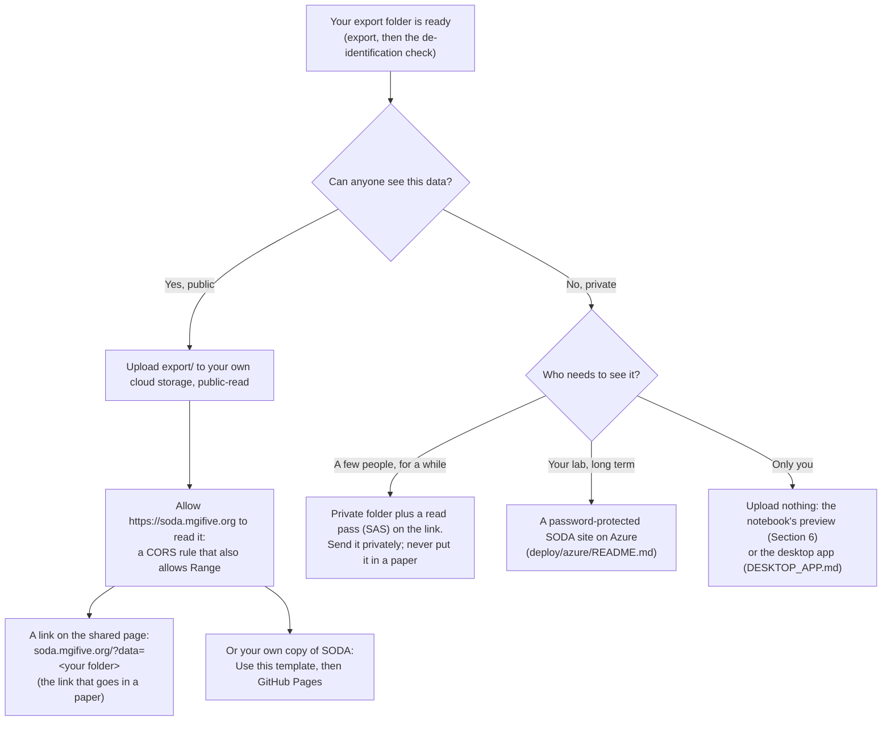

# Share your data: two ways

## Start here: who may see the data?

This is the last step, after the export and the de-identification check.



- **Public, shared page:** [1. Share a link](#1-share-a-link) below.
- **Public, your own copy:** [2. Make it your own](#2-make-it-your-own) below.
- **Private:** the same upload and link steps with a private folder and a read pass;
  for a password site see [deploy/azure/README.md](../deploy/azure/README.md) and
  [HOSTING.md](HOSTING.md). Only you: [DESKTOP_APP.md](DESKTOP_APP.md).

GitHub holds only the SODA page, never your data. Box, Google Drive and Dropbox cannot
serve the data (no Range requests, no CORS rule), so use cloud storage that can (the table
in Step 3).

---

You have prepared your data (one folder per dataset, from `prepare.py export` or the
notebook). There are two ways to let other people look at it.

| | **1. Share a link** | **2. Make it your own** |
|---|---|---|
| What you get | a link that opens your data on the shared SODA page | your own SODA website, which you can change |
| What you change | names, groups, title, which stains show: in one text file next to your data | anything: the same, plus the code itself |
| Where your data lives | your own storage | your own storage |
| Needs | storage that serves files over https | the same, plus a free GitHub account |
| Fixes and new features | arrive by themselves | you pull them in yourself |
| Effort | about 15 minutes after the upload | about 30 minutes the first time |

Most people only need the first. Start there; you can switch to the second later without
redoing anything, because both read the same data folder.

Either way, **your data is never copied onto anyone else's website.** The page only reads
your files from your storage while someone is looking at them.

**Using the notebook?** `notebooks/SODA_pipeline.ipynb` does most of the first way for you.
Its Section 4 runs `catalog.py` (Step 1; the title is `TITLE` in its advanced settings),
Section 5 runs the check (Step 2) when you have a de-identification key file, and Section 7
asks whether the data is public, prints the upload command (Step 3) and the link (Step 5,
built from `SODA_PAGE`), then tests the CORS rule (Step 4) and prints the exact fix for
your storage if it is missing.

---

## 1. Share a link

### Step 1. List your datasets

From the repository folder, with the environment active:

```bash
python web/SpatialViewer/catalog.py <your export folder> --title "Our nerve atlas"
```

This writes `datasets.json` in the export folder: the list of every dataset, the name the
page shows for each, and the heading it sits under. Open it in any text editor to rename or
regroup things (see [what you can change](#what-you-can-change-in-datasetsjson)). Running
`catalog.py` again later keeps your edits, adds new datasets and drops ones you deleted.

It stops, and says why, if it finds a private key file (`sample_id_key.csv`) or a prepare
cache in the folder: neither may be uploaded.

### Step 2. De-identify and check

```bash
python web/SpatialViewer/deid.py check <your export folder>
```

It must say clean before anything is uploaded. See [DEIDENTIFICATION.md](DEIDENTIFICATION.md).

### Step 3. Upload the whole export folder

Upload the folder as it is, keeping every file name and sub-folder, to storage that gives
each file its own web address:

| Storage | Works? | Notes |
|---|---|---|
| Azure Blob Storage | yes | public container, or a private one with a read-only SAS link |
| Amazon S3 | yes | public bucket, or a pre-signed / CloudFront link |
| Google Cloud Storage | yes | public bucket |
| A lab or department web server | yes | any server that serves files by name |
| GitHub Pages | small datasets only | a site is limited to 1 GB |
| Box, Google Drive, Dropbox, OneDrive | **no** | their share links open a preview page, not the files, and they do not let other sites read them |

### Step 4. Let the SODA page read it (one setting, once)

Browsers only let a page read files from another website if that website says so. This is
called CORS. Set it once on your storage, allowing the address of the SODA page.

The page reads one gene at a time out of the export's gene packs (a few large files per layer)
with an HTTP **Range** request ("bytes 4,128 to 6,563 of this file"). So the rule must also
allow the `Range` request header (some browsers ask first, in a "preflight") and let the page
see the `Content-Range` answer header. The rules below do both:

- **Azure:** Storage account → Resource sharing (CORS) → Blob service: Allowed origins
  `https://soda.mgifive.org` (the shared SODA page; you may add `https://five-mgi.github.io` too, its GitHub address, which redirects there; for your own copy of SODA, its address), Allowed methods `GET, HEAD, OPTIONS`,
  Allowed headers `*`, Exposed headers `*`, Max age `3600`. (`*` includes `Range` and
  `Content-Range`. If you list headers instead, allow at least `range` and expose
  `content-range, content-length`.) Blob storage answers Range requests by itself, also
  through a read pass (SAS) on the link.
- **Amazon S3:** Bucket → Permissions → CORS:
  ```json
  [{ "AllowedOrigins": ["https://soda.mgifive.org"], "AllowedMethods": ["GET", "HEAD"],
     "AllowedHeaders": ["*"], "ExposeHeaders": ["Content-Range", "Content-Length"], "MaxAgeSeconds": 3600 }]
  ```
- **Google Cloud Storage:** save the same rule as `cors.json`
  (`[{"origin": ["https://soda.mgifive.org"], "method": ["GET", "HEAD"], "responseHeader": ["Content-Type", "Range", "Content-Range", "Content-Length"], "maxAgeSeconds": 3600}]`)
  and run `gcloud storage buckets update gs://<bucket> --cors-file=cors.json`.
- **A web server:** see the nginx example in [HOSTING.md](HOSTING.md#host-notes). Apache,
  nginx and IIS answer Range requests for static files by default.

If you skip this, the page says it "could not reach" your folder and points here. If the
storage does not answer Range requests at all (a few file-sharing services and proxies), a
gene comes back as its whole pack: the page copes with packs up to 160 MB, slowly, and
otherwise says the host does not support Range requests. Use storage that answers Range
requests (blob storage, S3, GitHub Pages, nginx).

### Step 5. Make the link

Take the web address of your export folder (the folder that holds `datasets.json`), and
put it after `?data=` on the address of the shared SODA page, https://soda.mgifive.org/
(or of your own copy of SODA):

```
https://soda.mgifive.org/index.html?data=https://yourstorage.blob.core.windows.net/soda/our-atlas/
```

Open it yourself first. You should see your title and every dataset in the list. Then
share it: anyone with the link sees your data, nobody else's.

If your storage link has a read pass on the end (Azure's `?sv=...&sig=...`, an S3
pre-signed link), keep it: the page adds it to every file it reads. **Anyone with the link
can then read the folder** until the pass expires, so treat that link like a password.

**Copy link to this view** in the page's Save tab gives the same address plus the dataset on
show and the view as it looks now: position and zoom, genes, stains, colours, clusters and
their names, the quality filter. The view is in the part after `#`; the `?data=` part stays
as it is, read pass included, so that link is as private as the one you were given. Drawn
shapes are in it when they fit (the message under the button says when they do not). To pass
on a Draw a region result, send the file from **Save JSON**; the other person opens the same
dataset and uses **Load JSON**.

If something is wrong, the page says what in plain words: no `datasets.json` in the folder
(run Step 1 and upload again), the storage refused (the folder is private and the link has
no read pass), or it could not be reached (Step 4, or a wrong link).

### What you can change in datasets.json

Everything below is optional. Edit the file in any text editor, save, and upload it again
(only this one file). Reload the page to see the change.

```json
{
 "soda": 1,
 "title": "Our nerve atlas",
 "byline": "Smith lab, 2026",
 "paper": "https://doi.org/10.1234/example",
 "default": "sciatic_01",
 "datasets": [
  {"id": "sciatic_01", "label": "Sciatic nerve, injured", "group": "Spatial transcriptomics", "kind": "visium",
   "tags": {"tissue": "sciatic nerve", "condition": "injured", "slide": "S12"}},
  {"id": "sciatic_ifx", "label": "Sciatic nerve, 30-plex", "group": "Protein images", "kind": "akoya",
   "hideChannels": ["CD11c test"], "defaultChannels": ["DAPI", "CD3", "CD68"]}
 ]
}
```

| Setting | What it does |
|---|---|
| `title` | the name at the top of the page and on the browser tab |
| `byline` | the small line under it, e.g. your lab and year |
| `paper` | where "Link to paper" goes (must start with `https://`) |
| `default` | the dataset opened first (its `id`) |
| `label` | what the dataset list shows for that dataset |
| `group` | the heading it sits under; headings appear in the order they first occur |
| order of `datasets` | the order in the list |
| `tags` | short labels such as `{"tissue": "nerve", "condition": "injured", "slide": "S12"}` (any names you like). The dataset list then gets one drop-down filter per name, and its search also finds the values. Text only: a name up to 40 characters, a value up to 80, at most 20 per dataset (anything else is ignored). A name that has the same value on every dataset gets no filter. |
| `hideChannels` | stains to leave out of the list, e.g. test stains (exact names) |
| `defaultChannels` | stains switched on when the dataset opens (part of a name is enough, so `"Axon"` also turns on `"Axon-488"`) |
| `labelPositions` | hand-placed UMAP cluster labels, from `tools/label_editor.html` |

Do not change `id`: it is the folder's name. You can also put an `about.html` next to
`datasets.json`; the page shows it under "About" (headings, paragraphs, lists, bold and
italic, and https links are kept; anything else is removed).

---

## 2. Make it your own

Your own copy of SODA, on your own free web address, that you can change however you
like. Your data still lives in your storage (Steps 1–4 above); your copy just opens it
without the `?data=` part, and can have your name, logos and code changes.

Passwords, every label and colour setting, the notebook's settings and a map of the code
are in one guide: [ADVANCED.md](ADVANCED.md).

### Step 1. Copy SODA on GitHub

On SODA's GitHub page, click **Use this template → Create a new repository**. Pick a name
with `soda` in it (for example `yourlab-soda`) and make it **Public** (free GitHub Pages
sites have to be).

### Step 2. Turn on its website

In your new repository: **Settings → Pages → Build and deployment → Source: GitHub
Actions.** Then **Actions → pages → Run workflow**. A minute later your site is at

```
https://<your GitHub name>.github.io/<repository name>/
```

From now on, every change you save to the `main` branch republishes it by itself.

### Step 3. Point it at your data

In your repository, **Add file → Create new file**, name it `web/SpatialViewer/config.js`,
paste this, change the two lines marked, and **Commit changes**:

```js
window.SpatialViewerConfig = {
  data: "https://yourstorage.blob.core.windows.net/soda/our-atlas/",   // ← your export folder's link
  brand: { title: "Our nerve atlas", logos: [], byline: "Smith lab" },   // ← your names
  tokenEndpoint: "",
};
```

Your site now opens your data directly. The title, groups and other settings in your
`datasets.json` still apply. Add your site's address to the CORS rule of your storage
(Step 4 of the first way), e.g. `https://<your GitHub name>.github.io`.

(`config.js` is in `.gitignore` so that the main SODA repository never holds anyone's
settings. Creating it on the GitHub website, as above, works anyway. If you work with git
on your own computer, add it once with `git add -f web/SpatialViewer/config.js`.)

### Step 4. Change what you want

Edit files right on GitHub (the pencil icon) or on your computer. What people usually
change, from easiest to hardest:

| To change | Edit |
|---|---|
| names, groups, order, which stains show | `datasets.json` in your data folder (no code) |
| title, logos, byline, paper link, colours, gene limits | `web/SpatialViewer/config.js`; every option is explained in `config.example.js` |
| marker lists for suggested cluster names | `web/SpatialViewer/markers/*.json` |
| how the page looks | `web/SpatialViewer/styles.css`, `layout.css` |
| what the page does | `web/SpatialViewer/viewer.js` and the other `.js` files |

Logos go in `web/SpatialViewer/logos/` (also in `.gitignore`; add them on the website or
with `git add -f`).

### Getting SODA's later fixes

Your copy does not change when SODA does. To bring in a newer SODA, on your computer:

```bash
git remote add soda https://github.com/FIVE-MGI/SODA.git      # once
git pull soda main
```

Git merges SODA's changes with yours; if you both changed the same lines it asks you to
pick. If you changed only `config.js`, `datasets.json` and logos, there is nothing to pick.

### Keep in mind

- **Public repository, public code.** Never put the de-identification key, a prepare cache
  or anything private in it. Data does not belong in it either: keep data in storage.
- **Your copy, your fixes.** If you change the code, test it on your own data before you
  share the link.
- **Name your site after SODA**, for example `yourlab-soda`, so visitors know what they are
  using, and cite SODA in anything you publish with it (see the [README](../README.md#citing)).
